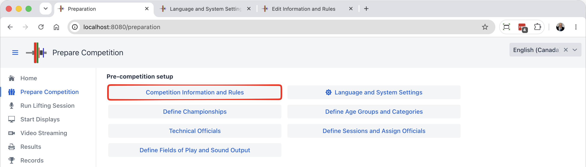
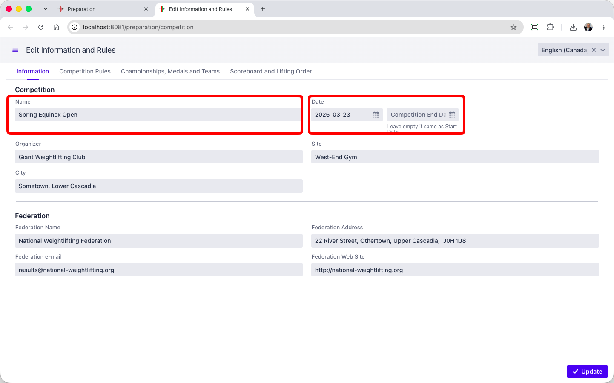
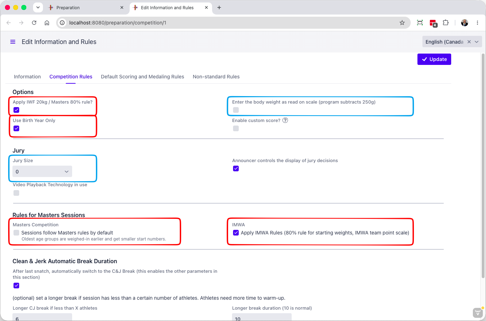
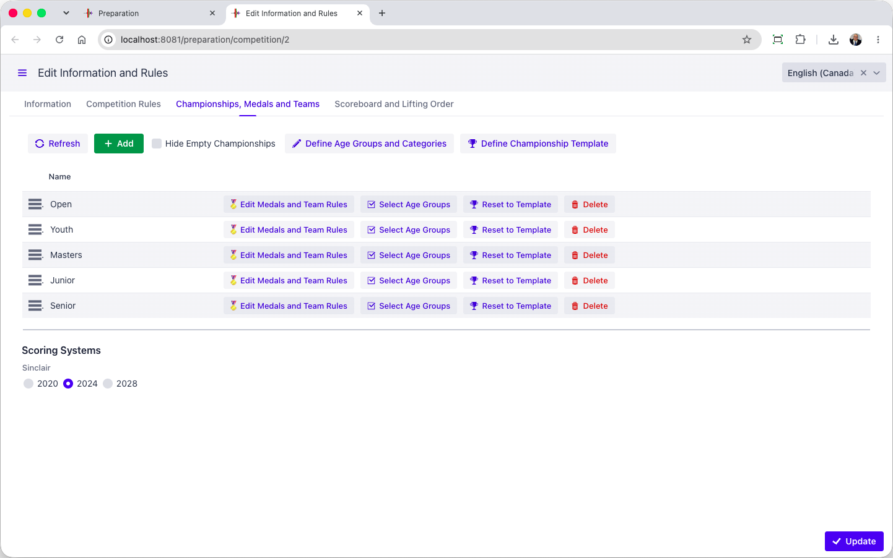

> This page focuses on the typical options. The full set of options is described in the [Competition Rules Reference](../100-AdvancedTopics/020-ReferenceCompetiionInformationAndRules) page.

The `Competition Information and Rules` button leads to a page where general rules and information about the competition are entered.

### Information

The page contains several tabs.  The Information tab is the first one, for general information about the meet.

First, the name and other data about the competition and hosting federation is provided. This information appears on screens and documents.  At the minimum, provide the name and the date(s).

### Competition Rules

These rules are global to the competition.  The typical options to set/check are in the red boxes.

- The `Use Birth Year Only` is typically used for local meets. Many federations use this as it limits the amount of personal information kept and displayed.
- The `Apply IWF 20kg / Masters 80% rule` determines whether the 20kg rule (20% for Masters) will be enforced. Some local or regional meets do not enforce this rule.
- Masters Sessions have some special rules
  - The `Apply IMWA Rules` ensures that the 80% rule is used, and that the team points calculations also follow IMWA rules (categories with 1 or 2 athletes count for less in the team points)
  - If you are running a Masters-only meet, check `Sessions follow Masters Rules by Default`. Otherwise, leave it empty. 
- If there is no Jury, set the Jury size to 0
- The `Enter the body weight as read on scale` is useful to avoid calculations in the weigh-in room.  With that option, if a male athlete weighs 65,25 kg, you enter 65,25 kg.  The system will know that the athlete is allowed 0,25 kg and record him in the 65 kg category.  The only thing the officials have to know is that 65,26 is over the category threshold, they don't need to subtract.

### Championships, Medals and Teams

This tab now contains the championship list and editor instead of the former competition-wide defaults form. In OWLCMS, each Championship defines how medals, best athletes and team scores work.

- Which events award medals: total only, snatch and clean and jerk only, or all three
- How to determine the best athlete award (GAMX is the official IWF scoring system since May 2026).  You may still be using Sinclair, QPoints, SMHF, or Robi, for example
- And whether there are team awards, and how they are computed

Use **Define Championship Template** above the list to edit the shared defaults, and **Reset to Template** to copy them to a selected championship. The default medal, scoring and team controls are no longer edited directly in the Competition Rules tabs. For details, see [Championships and Awards](050-Championships.md).

The screenshot below predates this rearrangement; use the championship list in the current tab.

