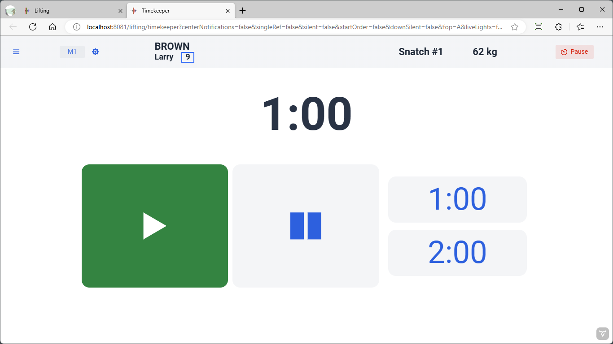

The timekeeper screen is straightforward.  It allows starting/stopping the time, and resetting the clock to the one-minute or two-minute timer value.

The timekeeper screen is often displayed on a tablet.  It works on iPhones, iPads and Android phones.

Use the on-screen buttons or a configured physical device to start, stop or reset the clock. The keyboard and programmable-keypad mappings are listed on [Refereeing Devices](../100-AdvancedTopics/180-RefereeingDevices#announcer-and-timekeeper-mappings).

The reset values are normally 1:00 and 2:00 and can be configured as described in [Configuration](../100-AdvancedTopics/140-Configuration#athlete-timer-parameters).
