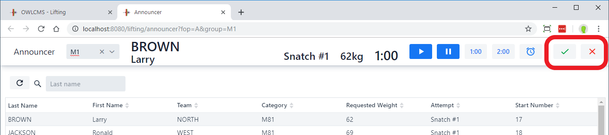
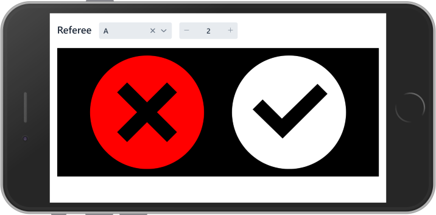
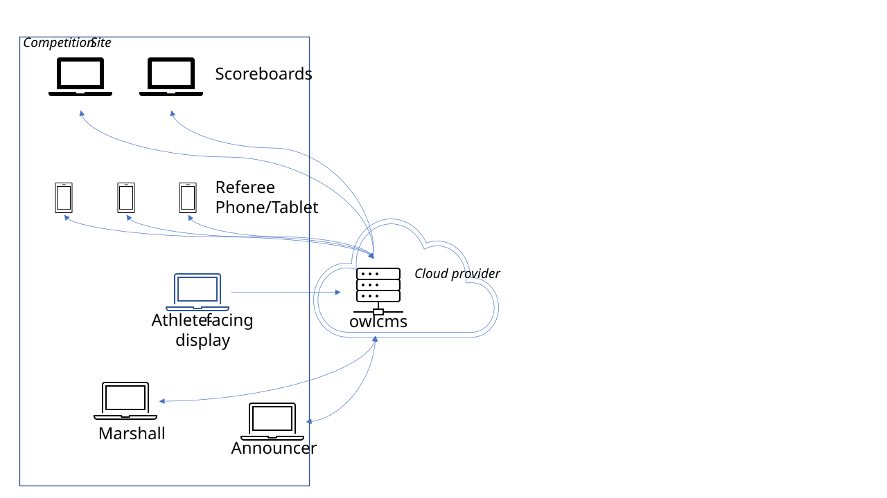

OWLCMS supports using refereeing devices and 3, 4 and 5-member juries, including the TCRR 2026 seven-person Adjudication Panel. See [Jury Control](./020-Jury) for the voting and review workflows. The decisions are displayed to the public and athletes on the displays started on the [Start Displays](../070-ScoreboardsAndResults/010-Displays) page.

Referees can use phones or tablets, USB or Bluetooth programmable keypads, build-your-own MQTT devices based on owlcms-firmata, commercial devices such as Blue Owl, or fully custom MQTT devices. Equipment, construction and shortcut mappings are described on [Refereeing Devices](../100-AdvancedTopics/180-RefereeingDevices).

This page covers their use during lifting. If no devices are used, the announcer records decisions given with flags, cards or hand signals.

## Manual Refereeing

The referees give their decisions using flags/cards/hand signals. The announcer announces the decision and uses the buttons at the top right of his screen to enter the decision.  A single red or white indicator is shown to the public on the current attempt and scoreboard displays.

## Mobile Device Refereeing

 In this setup, each referee uses a phone, tablet or laptop.  

This uses the phone or tablet web browser, which connects to owlcms. It does not matter whether owlcms is running on a laptop or in the cloud.  This setup is therefore useful when running virtual competitions.

The refereeing screen is started from the "Run a lifting group" page, in the Referees and Jury section at the bottom.  The sequence would look like the following when done on a phone.

  

The refereeing screen can also be started directly from the phone/tablet by using a browser and adding `/ref` at the end URL for the competition site.   After starting the referee screen, select which referee is which (1, 2 or 3) using the numeric input at the top (use the + and - signs)

Feedback for entering a decision is given by greying out the other key.  The refereeing display is reset when an athlete gets fresh clock.

When the other two referees have entered a decision, a yellow bar with a blinking reminder is shown, as well as an audible beep.  This is only a reminder, and the referee can wait as long as needed if they are not satisfied that the athlete has completed the lift.  The reminder goes away when the decision is entered.

When the jury wants to call the official, a red bar with blinking text is shown.  The call goes away when the competition is resumed.

## Button Keypads

Use the red or white button programmed for your referee position. The hosting browser must remain on the appropriate OWLCMS display; click its background to give it keyboard focus.

The browser receives the decisions and emits the down signal when two referees agree. The hosting display provides the visual and audible feedback; a keyboard-only keypad does not receive reminders or summons itself.

See [USB or Bluetooth Programmable Keypads](../100-AdvancedTopics/180-RefereeingDevices#usb-or-bluetooth-programmable-keypads) for connection, programming and shortcut tables.

## MQTT Devices

Build-your-own owlcms-firmata devices, commercial Blue Owl devices and fully custom MQTT devices send decisions to the OWLCMS platform they are configured for. Use the red or white button for the decision; OWLCMS records it and updates the displays automatically.

Feedback-capable devices can remind the third referee to decide and summon referees to the jury table. During a seven-person Adjudication Panel review, the referees vote again when the Chair calls for votes; the review votes remain hidden until all seven officials have voted. See [Jury Control](./020-Jury) for that sequence.

See [Refereeing Devices](../100-AdvancedTopics/180-RefereeingDevices) for equipment and setup, and the manufacturer's or project's instructions for the indicators and sounds of a particular device.
