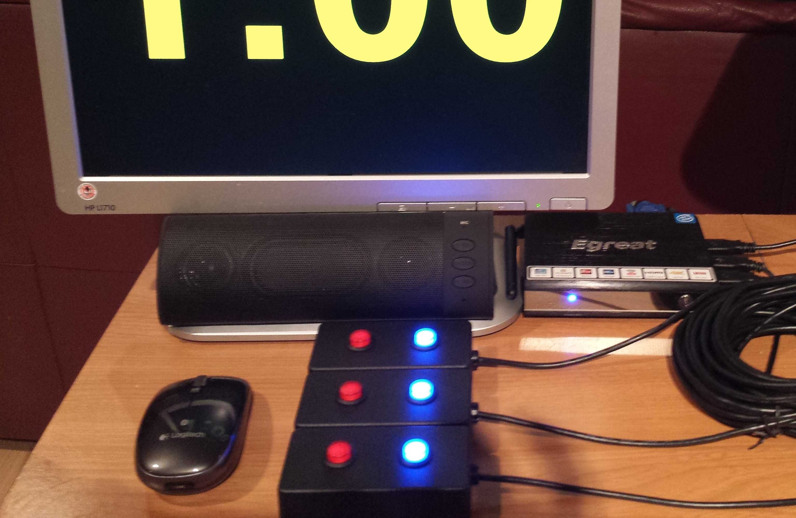
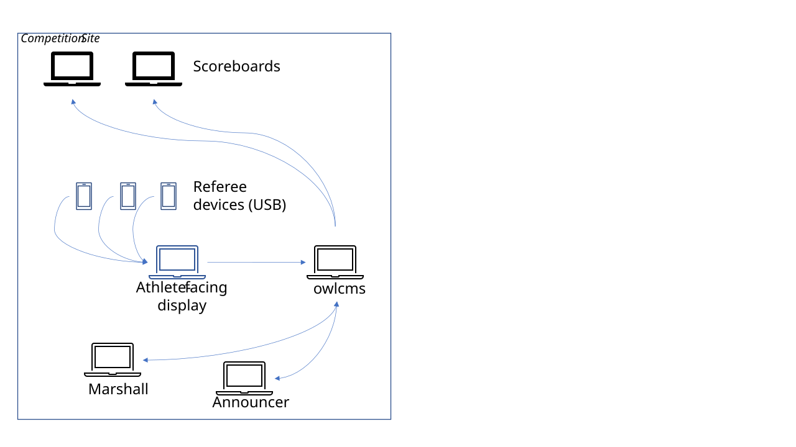
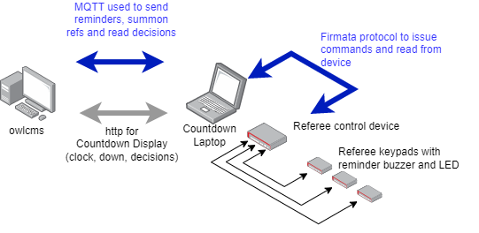
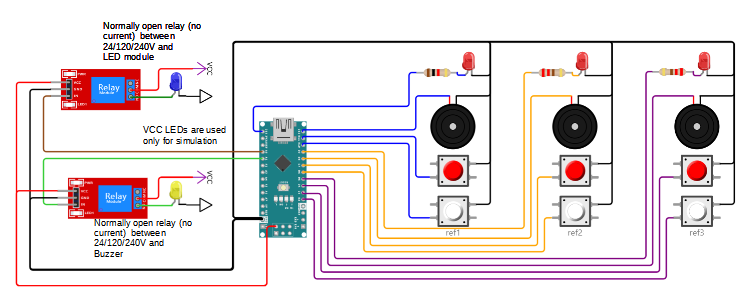
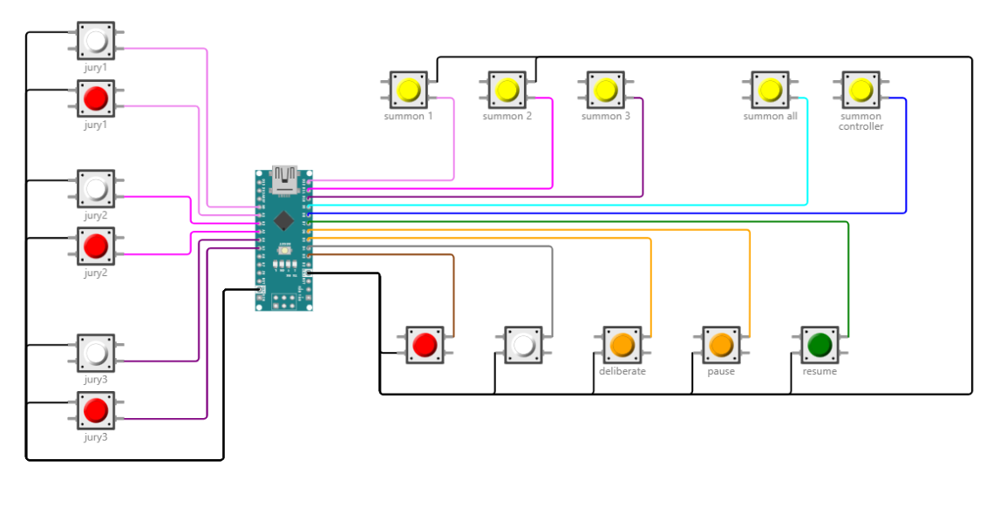
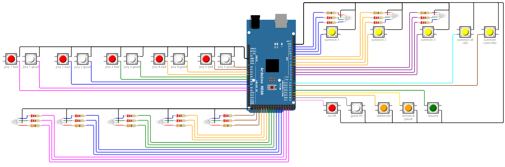

# Refereeing Devices

There are five ways to provide referee, jury and timekeeper devices:

1. [Phones and tablets](#phones-and-tablets).
2. [USB or Bluetooth programmable keypads](#usb-or-bluetooth-programmable-keypads).
3. [Build-your-own MQTT devices based on owlcms-firmata](#build-your-own-mqtt-devices).
4. [Commercial devices, such as Blue Owl](#commercial-devices).
5. [Fully custom devices using the documented MQTT messages](#fully-custom-mqtt-devices).

This page covers equipment, setup and keypad mappings. For operation during a competition, see [Refereeing](./010-Refereeing), [Jury Control](./020-Jury) and [Timekeeping](../050-RunningACompetition/040-Timekeeping).

## Phones and Tablets

The simplest approach is to open the referee or jury-member page in a phone or tablet's browser. No buttons need to be programmed and no device software needs to be installed.

The browser connects to the OWLCMS address, whether OWLCMS runs on the competition laptop or in the cloud. Select the correct platform and referee or jury-member position before testing.

The referee page provides decision buttons, reminders and summons. See [Mobile Device Refereeing](./010-Refereeing#mobile-device-refereeing) for the operating sequence.

## USB or Bluetooth Programmable Keypads

A programmable keypad sends keyboard shortcuts to a browser. Referees and jurors can rest a finger on a physical red or white button instead of using a touchscreen.

### Choosing and Connecting Keypads

- **USB keypads** connect to a laptop or mini PC, directly or through a USB hub.
- **Bluetooth keypads** can also be used with compatible tablets and computers.
- The keypad's programming software must be able to send the keys in the tables below, including modifiers where required.

Two-button USB keypads are available from electronics suppliers. Red and white keycaps or stickers identify the decisions. Use the supplier's programming software to assign the keys for each official.

[Delcom](https://www.delcomproducts.com/productdetails.asp?PartNumber=706502-5M) is another example of a supplier of physical USB buttons.

For referees, connect the keypads to the computer driving the athlete-facing display, attempt board or scoreboard. The browser can emit the down signal directly, without waiting for a round trip to the main OWLCMS computer.

A keyboard-only keypad does not receive OWLCMS reminders or summons itself; the hosting browser provides the display and sound. Use a feedback-capable MQTT device when the official needs indicators or a buzzer on the device.

Existing USB joystick buttons can be reused by mapping their buttons to the same keyboard shortcuts with software such as [JoyToKey](https://joytokey.net/), [antimicro](https://sourceforge.net/projects/antimicro.mirror/) or `qjoypad`. This is another way to supply keyboard input, not a different OWLCMS protocol.

### Keyboard Layout and Browser Focus

Shortcuts refer to the key positions on a [US keyboard](https://kbdlayout.info/kbdus), not necessarily the characters printed on the local keyboard. They follow the [browser keyboard-code standard](https://www.w3.org/TR/uievents-code/#key-alphanumeric-writing-system).

For example, the number-row key `Digit1` is printed `1` on a US keyboard but can produce `&` on a French keyboard. Test the programmed keypad with the keyboard layout used on the competition computer.

Keep the OWLCMS browser tab active. For a keypad attached to a decision display, click in the display's background so the browser receives the keypresses. Jury-member keypads must target the Jury Control page.

### Referee and Jury-Member Mappings

Odd digits mean **Good Lift**; even digits mean **No Lift**. The first three pairs are the same for referees and jury members.

| Referee | Jury member | Good Lift | No Lift |
| --- | --- | --- | --- |
| 1 | 1 | `1` | `2` |
| 2 | 2 | `3` | `4` |
| 3 | 3 | `5` | `6` |
| - | 4 | `7` | `8` |
| - | 5 | `9` | `0` |

Configure only the jury positions used by the competition. Four jury members with VPT form the seven-person Adjudication Panel with the three referees; they do not require seven jury-member keypads.

### Jury Chair Mappings

Connect the Jury Chair keypad to the computer running Jury Control.

| Key | Action |
| --- | --- |
| `D` | Jury Deliberation |
| `C` | Challenge |
| `T` | Technical Issue |
| `Y` | Call the Technical Controller |
| `H` | Summon referee 1 |
| `I` | Summon referee 2 |
| `J` | Summon referee 3 |
| `K` | Summon All |
| `G` | Chair-entered Good Lift during a review |
| `B` | Chair-entered No Lift during a review; opens the technical-rule selection |
| `Escape` | Resume Competition |

The `K` key follows the physical jury box's **Summon All** action. During a seven-person panel review, or a jury-only review with automatic stop enabled, it calls the review vote. Otherwise it summons the referees. See [Calling Referees Versus Calling a Vote](./020-Jury#calling-referees-versus-calling-a-vote).

The shortcuts obey the same review rules as the buttons. In particular, an invalid Challenge is ignored, and `G` / `B` are Chair-entered decisions, not shortcuts for confirming a completed vote. Vote confirmation, technical-rule selection and **Cancel vote result** are performed on the screen.

The `noJuryAlphabeticalShortcuts` [feature switch](../100-AdvancedTopics/150-FeatureToggles) disables the Jury Chair shortcuts while retaining the jury-member digit mappings.

### Announcer and Timekeeper Mappings

These clock shortcuts work on the active Announcer and Timekeeper pages when the user is allowed to control the clock.

| Action | Keyboard key | Numeric keypad key |
| --- | --- | --- |
| Start clock | `,` (`Comma`); `/` (`Slash`) where enabled | `/` (`NumpadDivide`) |
| Stop clock | `.` (`Period`) | Decimal key (`NumpadDecimal`) |
| Toggle start/stop | `*` (`Shift` + `8` on a US keyboard) | `*` (`NumpadMultiply`) |
| Reset to one-minute value | `+` (`Shift` + `=` on a US keyboard) | `+` (`NumpadAdd`) |
| Reset to two-minute value | `=` or `;` (`Semicolon`) | `=` (`NumpadEqual`) |

The number-pad decimal key works even when its label is a comma. The ordinary `/` shortcut is disabled for Spanish unless the `keepSpanishHyphenShortcut` feature switch is enabled; number-pad Divide remains available.

Programmable Bluetooth buttons, such as [Flic in Universal mode](https://flic.io/flic-universal), must send the corresponding shortcut and modifiers. Prefer the numeric-keypad codes when the device can generate them.

The active Announcer page also uses **F2** for a manually entered Good Lift and **F4** for a No Lift. These are not the three individual referee decisions.

The one-minute and two-minute reset values are normally 1:00 and 2:00. See [Athlete Timer Parameters](../100-AdvancedTopics/140-Configuration#athlete-timer-parameters) for configuration.

## Build-Your-Own MQTT Devices

[owlcms-firmata](https://github.com/owlcms/owlcms-firmata) provides designs and software for referee, jury, timekeeper and down-signal devices. Arduino boards are a way to build these MQTT devices, not a separate category of device.

The Arduino runs the supplied Firmata firmware. The owlcms-firmata interface program connects the hardware to OWLCMS over MQTT. The project supplies the firmware, interface software, schematics and configuration instructions; building the standard designs does not require writing your own application.

Follow the [project's installation and wiring instructions](https://github.com/owlcms/owlcms-firmata). Adjust its configuration if your build uses different pins or omits components.

### Referee Device

A referee device can include red/white decision buttons, reminder and summon indicators, and a buzzer. The following design also controls an external down-signal light and sound.

### Button-Only Jury Box

The Chair and jury members use physical buttons while reading the decisions on Jury Control. This avoids programming a keyboard-emulating keypad: the supplied interface handles the buttons.

### Jury Box with Indicators

A full jury box includes referee and jury indicators as well as buttons. This five-member design can be built with three or four jury-member positions instead.

The physical controls follow the workflows in [Jury Control](./020-Jury). In particular, the physical Good Lift / No Lift buttons apply the Chair's decision directly; they do not provide the on-screen technical-rule dialog.

For connection settings, see [MQTT Configuration](../100-AdvancedTopics/190-MQTT).

## Commercial Devices

[Blue Owl](https://blue-owl.nemikor.com) provides commercial referee and jury devices. Use the manufacturer's setup instructions and select the correct OWLCMS platform.

Check the device and firmware's support for the competition's jury size and review workflow before the meet. The seven-person panel requires referee review votes as well as jury votes, with the votes hidden until all seven officials have voted.

Commercial MQTT devices use the same OWLCMS competition workflows as build-your-own devices.

## Fully Custom MQTT Devices

You can implement your own device or interface using the documented [MQTT Messages](../100-AdvancedTopics/200-MQTTMessages), without using owlcms-firmata. The hardware and programming language are your choice.

The implementation must both send official actions and process the OWLCMS feedback required by the device: resets, reminders, summons, hidden votes and revealed decisions. Follow the protocol's external-controller logic rather than assuming that every button press immediately changes the competition state.

Examples of custom implementations include the [owlcms ESP32 project](https://github.com/jflamy/owlcms-esp32) and [M5Stack referee device](https://github.com/kingbutter/owlcms4-ref-m5stack-core2).

See [MQTT Configuration](../100-AdvancedTopics/190-MQTT) for the embedded broker, WebSocket connections and external brokers. See [MQTT Messages](../100-AdvancedTopics/200-MQTTMessages) for topics, payloads and device behavior.
