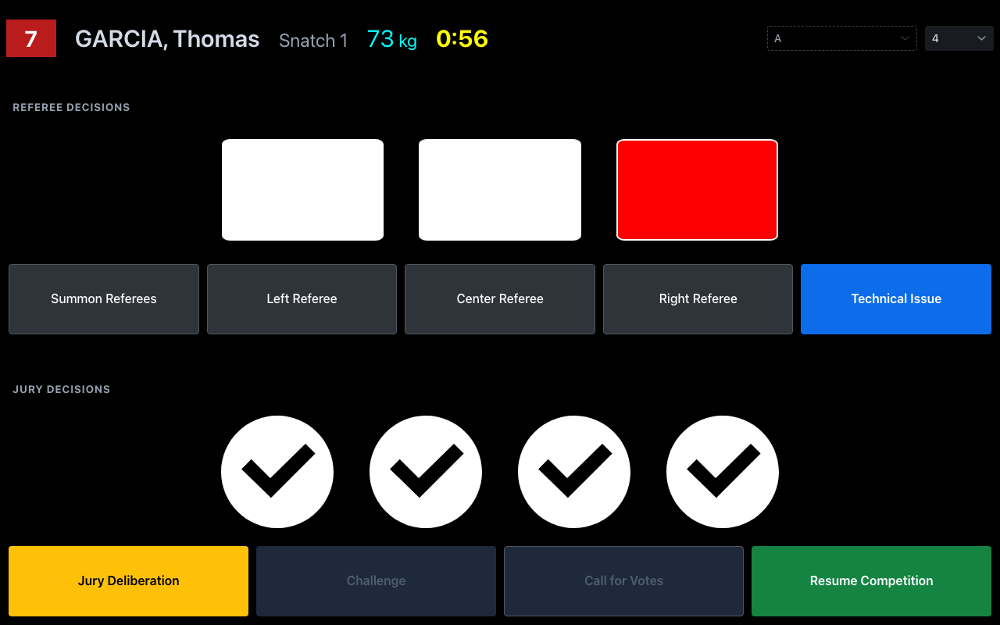
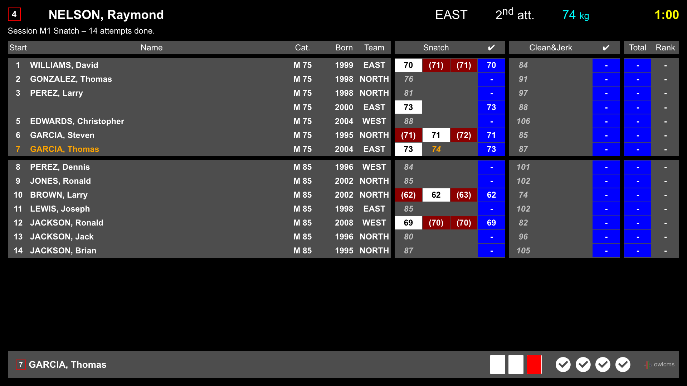
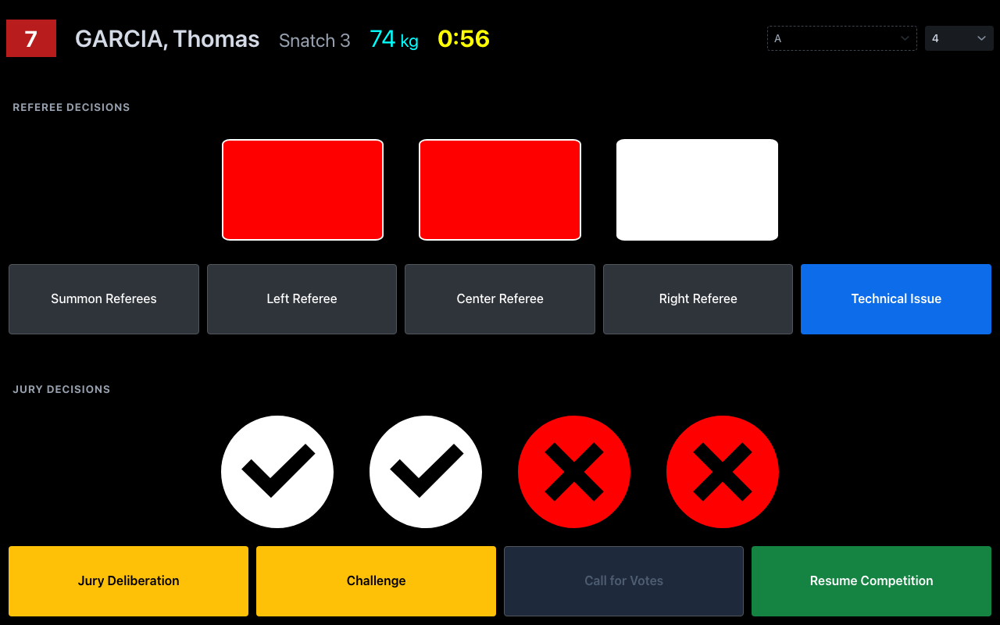
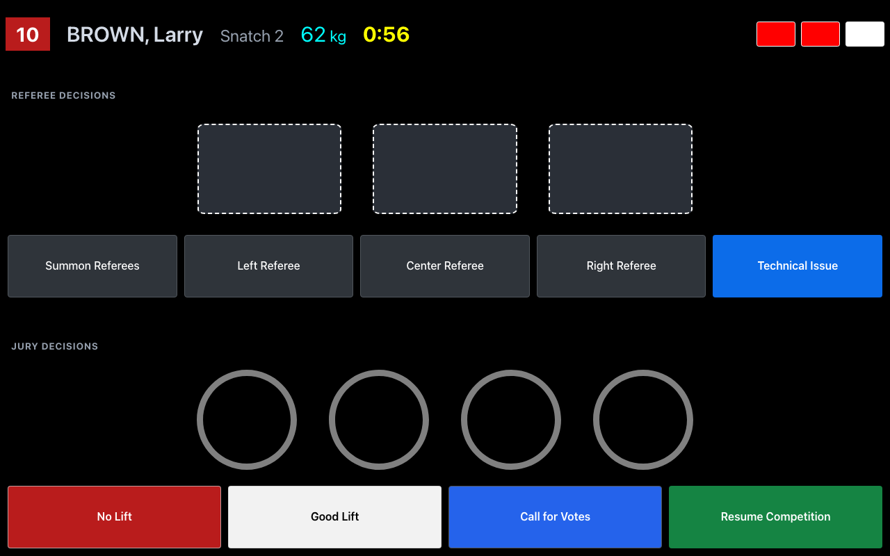
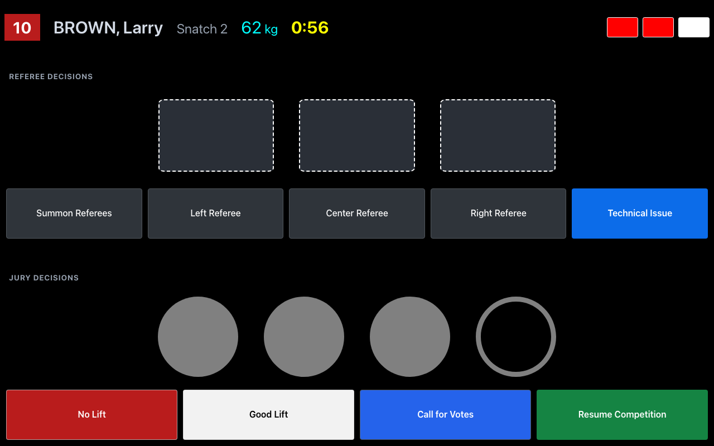
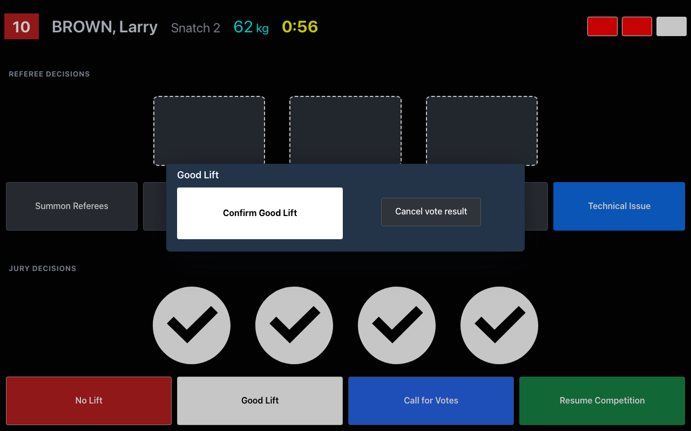
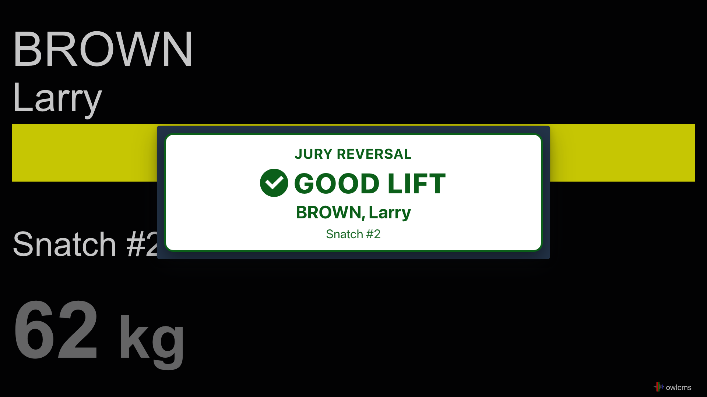
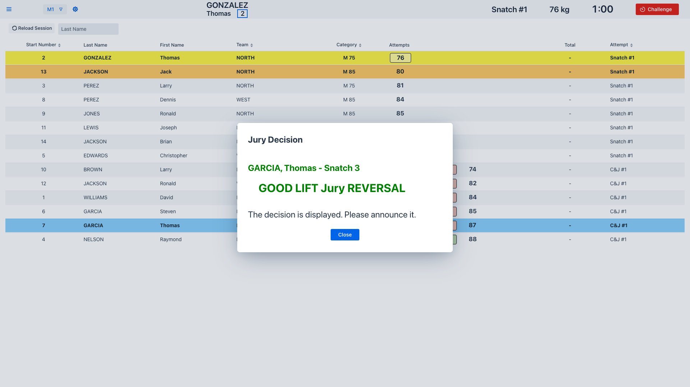

# Jury Control

The **Jury Control** page is the Jury Chair's working screen. It shows the referee and jury votes, starts a deliberation or challenge, calls a review vote, and applies the Chair's decision. Jury members vote with [keypads or MQTT devices](#jury-devices).

There are two different votes:

- **Votes on the lift:** the referees' decisions and the jury members' votes as they watch the lift.
- **Review vote:** a new vote after the jury starts a review. Its result waits for the Chair's confirmation or the technical rule for a No Lift.

Starting a review does not itself overturn the lift. Completing a review vote does not apply its result until the Chair takes the required action.

The following examples show the sequence for [a normal lift](#example-1-a-normal-lift), a [seven-person reversal to No Lift](#example-2-reversal-to-no-lift), and a [four-person challenge](#example-3-a-four-person-challenge).

## Opening Jury Control

From **Run Lifting Session**, select the correct platform and open **Jury Control**.

Jury Control is an operator page.

## Jury Sizes

Set the competition's default jury size and **Video Playback Technology** (VPT) on the [Competition Rules](../030-PreCompetitionSetup/020-CompetitionInformationAndRules) page. Jury Control also offers a jury-size selector for its platform. With TCRR compliance enabled, the jury size is fixed at 4 and that selector is hidden.

The two main workflows are:

| Configuration | When a review starts | Who votes in the review | Rule for overturning the referees |
| --- | --- | --- | --- |
| **4 members with VPT** (TCRR 2026) | Automatically when the combined majority is against the referees; also by Challenge or Jury Deliberation | The 3 referees and 4 jury members: the seven-person **Adjudication Panel** | Majority of the seven |
| **4 members without VPT** | At the Chair's request | The 4 jury members only | Unanimity |

**A three-person jury without VPT follows exactly the same workflow as a four-person jury without VPT.** There are three circles instead of four, and all three must agree to overturn the referees. The four-person challenge below illustrates both cases.

Five-person juries use the jury-only workflow too: unanimity without VPT, majority with VPT. A three-person jury still requires unanimity if VPT is enabled. Jury size **0** means no jury vote, review, deliberation or challenge.

The examples use the default setting: `automaticBreakNoVPT` is off. An [optional automatic stop](#optional-automatic-stop-without-the-panel) changes when a jury-only review starts and when its vote opens.

## Reading Jury Control

The screen is organized as follows:

- **Top line:** athlete, lift, weight and platform. During a review, the athlete is the one whose lift is under review, not the next athlete in the lifting order.
- **Referee decisions:** rectangular lights, shown as soon as the referees decide.
- **Summon and Technical Issue buttons:** call all referees, one referee, or start a technical break.
- **Jury decisions:** circles. An empty outline means no vote; a filled grey circle means the member has voted, but the vote is still hidden. Red and white are revealed only when the vote is complete.
- **Action row:** outside a review, **Jury Deliberation** and **Challenge** are shown. During a review, **No Lift** and **Good Lift** take their places. **Call for Votes** is enabled during a review, and **Resume Competition** ends the break without applying a new lift decision.

When a review vote clears the main referee indicators, the original referee decision is kept at the top right. It remains there through the review, the decision and Resume, until the next athlete's clock starts.

## Example 1: A Normal Lift

This example uses a four-member jury with VPT. The referees give **two white lights and one red light: Good Lift**. All four jury members then vote Good Lift, so there is no review.

1. Starting the athlete's clock clears the previous votes.
2. The referees decide the lift. Their lights are visible on Jury Control as they are entered.
3. The jury members vote. Until the fourth juror votes, the circles show only who has voted, not their decisions.
4. The fourth vote reveals all four decisions. Here the combined majority agrees with the referees, so no action is required from the Chair.

The announcer's screen and the scoreboard top line move to the next athlete after the normal referee-decision display period, even while jury votes are missing. The attempt board and scoreboard decision section stay on the athlete who just lifted.

In the following screenshot, the scoreboard top line already shows NELSON, while the decision section at the bottom still shows GARCIA and the completed votes.

After the last jury vote, the attempt board holds the decision for 10 seconds and the scoreboard decision section for 20 seconds, unless the next clock starts first. Starting that clock clears the previous votes. **There is no Call for Votes, Chair confirmation or Resume for a normal lift.**

**The next clock cannot start while jury votes are missing.** This also applies when jury decisions are hidden on an attempt board.

If a device fails:

- The Chair can start a deliberation and enter a decision using **Good Lift** or **No Lift**.
- The announcer can confirm **Start clock anyway**. This abandons the incomplete votes and lets the referees' decision stand.

## Seven-Person Adjudication Panel (TCRR 2026)

### Example 2: Reversal to No Lift

The referees give **two white lights and one red light: Good Lift**. The four jury members all vote **No Lift**. The combined seven-person majority is against the referees, so OWLCMS starts an automatic review.

#### 1. Automatic Review Starts

The competition stops with **Adjudication Panel Review**. The votes on the lift stay displayed so the jury can record them. **No review vote starts yet.** The orange **Call for Votes** button prompts the Chair for the next step.

The attempt board identifies the athlete and the review.

#### 2. The Chair Calls the Review Vote

After recording the votes and watching the [video replay](./030-JuryReplays), the Chair presses **Call for Votes** on Jury Control. On a jury box or Jury Chair keypad, **Summon All** has the same effect.

The vote indicators are cleared, the referee devices are re-armed and buzzed, and **all seven officials vote again**. Grey indicators show who has voted without revealing the values. The original referee decision is retained at the top right.

#### 3. The Completed Vote Requires a Reason

When the seventh vote arrives, all seven decisions are revealed. In this example, the majority is **No Lift**. The competition remains stopped: the Chair must select the technical rule before the result is applied.

Jury Control opens the rule selection. Here the Chair selects **1 - Bending and extending of the arms**.

#### 4. The No Lift and Its Reason Are Displayed

Selecting the rule applies the reversal. The attempt board identifies the reviewed athlete and lift and shows **Jury Reversal - No Lift**, with the reason.

The announcer receives the same decision and reason, even though the next athlete may already be shown behind the notification.

#### 5. The Announcer Announces; Lifting Resumes Automatically

The announcer announces the **No Lift and the reason**, then uses **Close**. Lifting resumes automatically after the outcome display period; it does not wait for Close. **The Chair does not press Resume after applying the decision.**

## Four-Person Jury Without VPT

### Example 3: A Four-Person Challenge

This example uses a four-member jury without VPT and the default manual-review workflow. A three-member jury without VPT follows the same steps, with three votes instead of four.

#### 1. No Lift; the Jury Is Split

The referees give **two red lights and one white light: No Lift**. The jury votes **two Good Lift and two No Lift**. This is not unanimous, so the referees' No Lift stands and the competition does not stop automatically. **Challenge** remains available.

#### 2. The Chair Starts the Challenge

The Chair presses **Challenge**. The competition stops and the announcer sees **Waiting for decision**.

Unlike the seven-person panel, the jury-only review vote **opens immediately**: the jury circles are cleared. The original referee decision is kept at the top right, while the main referee indicators are no longer used for the review.

#### 3. Only the Jury Votes Again

After discussing the lift, the Chair asks the four jury members to vote verbally. **The referees do not vote again**, and there is no need to press Call for Votes to open this first review vote.

Three grey circles and one empty circle mean three jurors have voted. Their choices remain hidden.

#### 4. Unanimous Good Lift; the Chair Confirms

The fourth vote reveals **four Good Lift decisions**. The required unanimity is reached, but the result still waits for the Chair's **Confirm Good Lift**.

#### 5. The Challenge Succeeds

The Chair confirms. The No Lift becomes a Good Lift, and the boards and the announcer's screen show the reversal. No technical-rule selection is needed for a Good Lift.

The announcer announces the Good Lift and closes the notification. As in the seven-person example, lifting resumes automatically and **no additional Resume is required**.

If the review vote is not unanimous, the challenge does not overturn the referees. The Chair instead confirms **Referee Decision Stands as Called**, with no new rule requested. With a three-person jury, all three must vote Good Lift for the challenge to succeed.

**Call for Votes** can restart a jury-only vote if needed. With automatic stop off, **Summon All** on a keypad or jury box summons the referees; it does not call the vote.

## Optional Automatic Stop Without the Panel

Enable `automaticBreakNoVPT` to stop the competition when the jury's votes on the lift meet its rule for overturning the referees: unanimity, or a majority for five members with VPT. Keep Jury Control open for this automatic stop.

The workflow then has the same separate stages as the seven-person panel:

1. An automatic review, **Jury Deliberation** or **Challenge** stops the competition.
2. The votes on the lift stay displayed. The review vote has **not** started.
3. After recording the votes and any discussion or replay, press **Call for Votes**. On a keypad or jury box, **Summon All** calls the vote.
4. Only the jury members vote again. The referee decision is retained, not replaced by new referee votes.
5. When all jury votes are in, the Chair applies the result.

During this workflow, the on-screen **Summon Referees** (all) button is disabled: use **Call for Votes** to start the vote, and the three individual summon buttons to call referees.

The Chair can also end the review with **Resume Competition** without calling or completing a vote. The referees' decision then stands.

## Applying the Review Result

A completed review vote waits for the Jury Chair. It does not change the result by itself.

| Result | Chair's action |
| --- | --- |
| **Good Lift** | Press **Confirm Good Lift**. |
| **No Lift** | Select the technical rule that was broken. The decision is applied when the rule is chosen. |
| **Jury-only vote does not meet its rule** | Press **Confirm Decision**. The referees' decision stands as called, whether it was a Good Lift or a No Lift. No new technical rule is requested. |
| **Vote must be repeated** | Use **Cancel vote result**, then **Call for Votes** for a fresh vote. |

These actions apply to both illustrated review workflows. Once applied, the outcome and its reason are shown on the boards and to the announcer.

**No additional Resume is required after an applied decision.** Lifting resumes automatically after the outcome display period. The announcer announces the decision and closes the notification; closing it does not control resumption.

### Decision Without a Vote

During a review, the Chair can use **No Lift** or **Good Lift** directly if a vote cannot take place or cannot be completed. Jury Control asks for the technical rule for a No Lift. The announcer's notification records **Jury Chair Entered Decision**.

If the Chair enters a decision against the result of a complete vote, it is applied but marked **Jury Chair Decision Against the Vote**. These labels distinguish a Chair-entered decision from the result of the officials' vote; they do not prevent it from being applied.

The **Good Lift / No Lift buttons on a physical jury box** apply the Chair's decision immediately, without a confirmation dialog or a technical-rule selection. If the decision matches a jury-only vote that did not meet its rule, the reason is **Referee Decision Stands as Called**. For any other No Lift without a recorded rule, the announcer must obtain the reason from the Technical Controller.

## Announcer

By rule, the announcer announces the jury's decision and the reason for an overturned lift.

1. When a review starts, the announcer sees **Waiting for decision**.
2. When the decision is applied, the notification shows the athlete, lift, decision and recorded reason.
3. The announcer announces them and uses **Close**. The competition does not wait for this action.

For a No Lift entered from a physical jury box without a rule, the notification asks the announcer to obtain the reason from the Technical Controller before announcing the decision and calling the next athlete. If the jury uses neither Jury Control nor a jury box, the Technical Controller relays the decision to the announcer, who records it with the notification's **Good Lift / No Lift** buttons.

## Deliberation, Challenge and Summon Rules

### Deliberation or Challenge

- **Jury Deliberation** can stop the competition to consider a lift or another matter, such as a weight change. It can be started after the next athlete's clock has begun; that clock is stopped.
- **Challenge** concerns the **athlete under review**: the last athlete who received a referee decision. It is valid only after a No Lift, before the jury has decided that lift, and when no Challenge or automatic review is already under way. It remains valid after the next athlete's clock has started.
- An invalid Challenge is disabled on Jury Control; the equivalent jury-box press is ignored.
- A manual Deliberation or Challenge can be relabeled using the other action on a keypad or jury box. Only the label changes, not the votes or lights. Repeating the current action does nothing.
- During any automatic review, Deliberation and Challenge actions do nothing.

### Calling Referees Versus Calling a Vote

The distinction matters when using a physical device:

| Action | Manual review, automatic stop off | Seven-person panel or automatic stop on |
| --- | --- | --- |
| **Call for Votes** on Jury Control | Starts or restarts the jury-only vote | Starts or restarts the review vote |
| **Summon All** on keypad or jury box | Calls the three referees | During a review, calls the vote. **This is because of the explicit wording used in TCRR**.  If you actually need to summon the referees, use the individual summon buttons for each of them. |
| **Individual summon buttons** | Call one referee | Call one referee |

Outside a break, summoning all or one of the referees starts a jury deliberation. Feedback-capable referee devices show or sound the summons. Summoning a referee is not a referee vote.

## Resume and Other Buttons

Use **Resume Competition** when the review ends **without applying a jury decision**, for example after checking a weight change or deciding not to pursue an automatic review. It ends the break and abandons any unfinished jury voting; it does not reverse the lift.

Resume does not clear Jury Control's displayed votes or the original referee decision in the top line. The next athlete's clock performs the visible reset. After lifting has already resumed automatically and the jury cycle has ended, Resume does nothing. During an ordinary break, Resume ends that break.

**Technical Issue** starts a technical break for a problem with the platform or equipment.

## What the Displays Show

These are the default durations; they can be changed in [Configuration](../100-AdvancedTopics/140-Configuration#decision-and-jury-display-durations).

| Stage | Attempt board | Scoreboard bottom decision section |
| --- | --- | --- |
| Referee decision, no jury | 3.5 seconds | 20 seconds |
| Jury votes on the lift are missing | Stays on the reviewed athlete until the votes finish | Same |
| Jury vote complete, no review | 10 seconds from the last jury vote | 20 seconds from the last jury vote |
| Review waiting for a vote or the Chair's decision | Stays on the reviewed athlete and the review | Same |
| Applied jury decision | Outcome card for 5 seconds | Outcome and reason for 20 seconds |

The announcer's screen and scoreboard top line can already show the next athlete while these decision displays stay on the previous lift. A new review takes over at once; starting the next athlete's clock ends the held decision display. An attempt board with **Show Jury Decisions** turned off follows the no-jury display duration, but this does not bypass the clock's wait for jury votes.

The normal clean & jerk intermission and the end of the session do not immediately erase the last decision. The same decision and review stages still apply, then the boards show the break or session-end display.

If the jury reviews the last snatch during the clean & jerk intermission, the full intermission starts again once the jury has decided. A review ended without a decision uses **Resume Competition**, not **Good Lift** or **No Lift**.

## Jury Devices

Jury members use the decision buttons for their assigned positions. The Chair uses Jury Control or the equivalent physical controls. These follow the review sequences above, including hidden votes, Call for Votes, decision confirmation and Resume.

Programmable keypads must target the Jury Control browser. MQTT devices are configured for the correct platform. On a physical jury box, **Summon All** can mean **Call for Votes**, while the individual summon buttons call one referee. The physical **Good Lift / No Lift** buttons apply a Chair-entered decision directly, without the screen's rule-selection dialog.

For the five equipment approaches, USB/Bluetooth mappings, owlcms-firmata builds, Blue Owl devices and custom MQTT implementations, see [Refereeing Devices](./015-RefereeingDevices).
