The jury is operated from the **Jury Control** page.  The jury members vote with keypads or with MQTT devices (see [Jury Devices](#jury-devices) below); the Jury Chair uses the Jury Control page, or a jury box, to start a deliberation, call the referees, and give the decision.

Jury Control is started from the "Run Lifting Session" page.

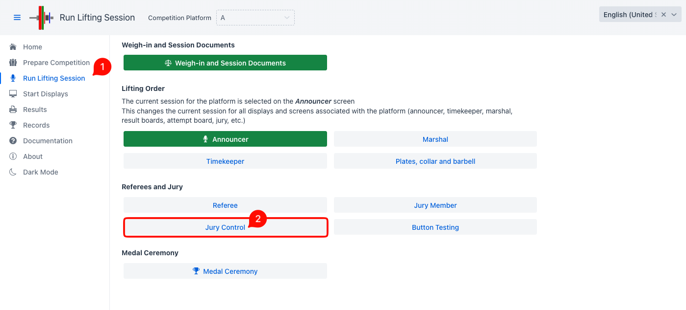

## Jury Sizes

owlcms supports the jury of the IWF 2026 Technical and Competition Rules and Regulations (TCRR) and the previous ones.

| Jury | Setting | Review |
| ---- | ------- | ------ |
| **4 members, Video Playback Technology** (TCRR 2026) | Jury size 4; "Video Playback Technology" checked in the Competition Rules | The seven-person **Adjudication Panel**: the 3 referees and the 4 jury members vote again on the video replay; the majority of the seven decides. |
| **4 members, no video playback** | Jury size 4; Video Playback Technology not checked | The jury deliberates at the Chair's request, and overturns the referees only when the 4 jury members are unanimous. |
| **3 or 5 members** (prior TCRR) | Jury size 3 or 5 | The jury deliberates at the Chair's request, and overturns the referees only when unanimous (a 5-member jury with video playback uses the majority). |

## Jury Control

The page has two parts.

- The top part shows the **referee decisions** <u>as soon as they are made</u>, with the buttons to summon the referees to the jury table (all, or one of them) and to start a technical break.
- The bottom part shows the **jury members' decisions**.  A grey circle shows that a jury member has voted; the votes are shown in red or white only <u>after all the jury members have voted</u>.  The bottom row has the jury actions: **Jury Deliberation**, **Challenge**, **Call for Votes** and **Resume Competition**.

With any configured jury (3, 4 or 5 members), the next athlete's clock cannot start until every juror has voted on the previous lift.  If a jury device does not work, the Jury Chair can enter the jury's decision with **Good Lift** / **No Lift**, or the Speaker can choose **Start clock anyway** to discard the incomplete jury votes and let the referees' decision stand.  If jury decisions are not shown on the attempt board, the next athlete may be announced while the jury finishes voting, but their clock is still blocked.

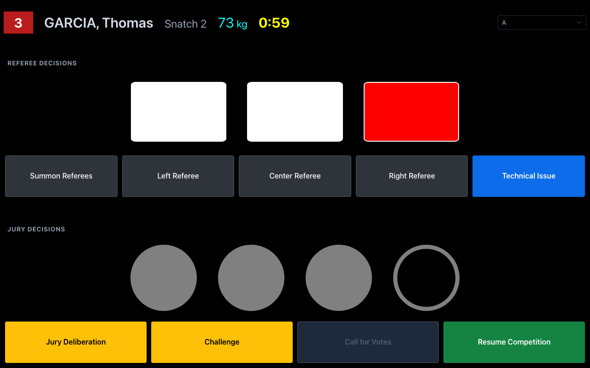

## Seven-Person Adjudication Panel (TCRR 2026)

With jury size 4 and video playback, the four jury members vote on every lift, as the referees do.  When jury decisions are enabled on the attempt board, the decision stays there until the four jury votes are in.

- If the combined majority of the seven officials agrees with the referees, the competition goes on.  A 2-2 jury leaves the referees' decision in place.
- If the combined majority is opposite to the referees, the competition **stops automatically** with an "Adjudication Panel Review".  The referees are called to the jury table to watch the video replay, and the votes on the lift stay displayed on Jury Control and on the boards.

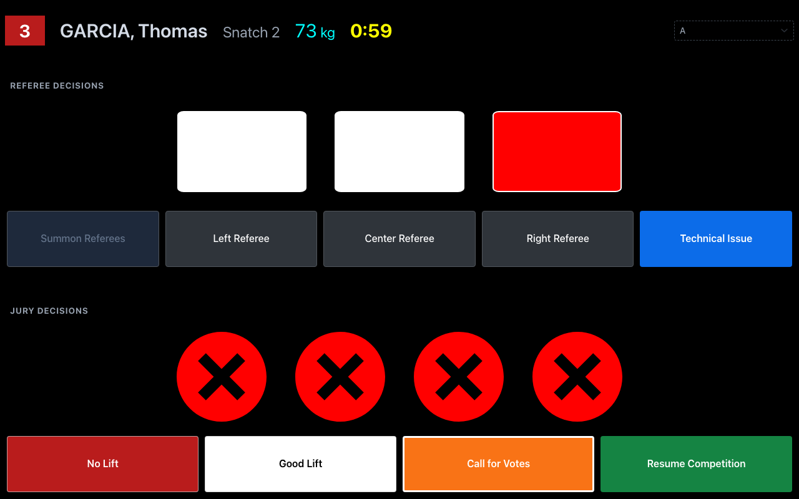

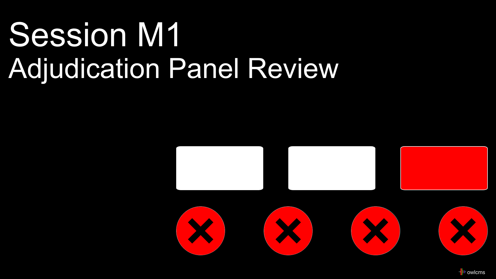

A **Challenge** (the "Challenge" button) follows the same procedure.

### Review Vote

After the replay, the Jury Chair presses the orange **Call for Votes** button (or Summon All on a jury box).  All the votes are cleared, the referee devices are buzzed, and the seven officials vote again.  While the vote is in progress, the devices and the boards show who has voted, without the values.

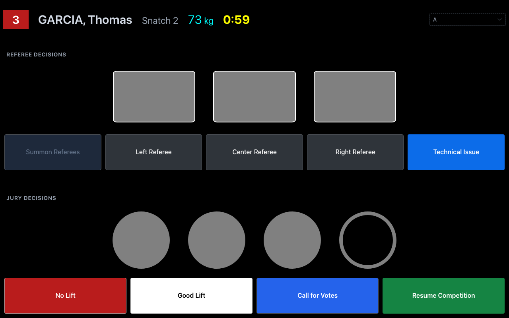

As soon as the seventh vote is in, the votes are revealed everywhere, and the result waits for the Jury Chair:

- For a **No Lift**, Jury Control asks for the technical rule that was broken.  The decision is applied when the rule is chosen, and the rule is shown on the boards.
- For a **Good Lift**, Jury Control asks the Chair to confirm.
- **Cancel vote result** clears the votes so that the vote can be called again (for example, if an official pressed the wrong button).

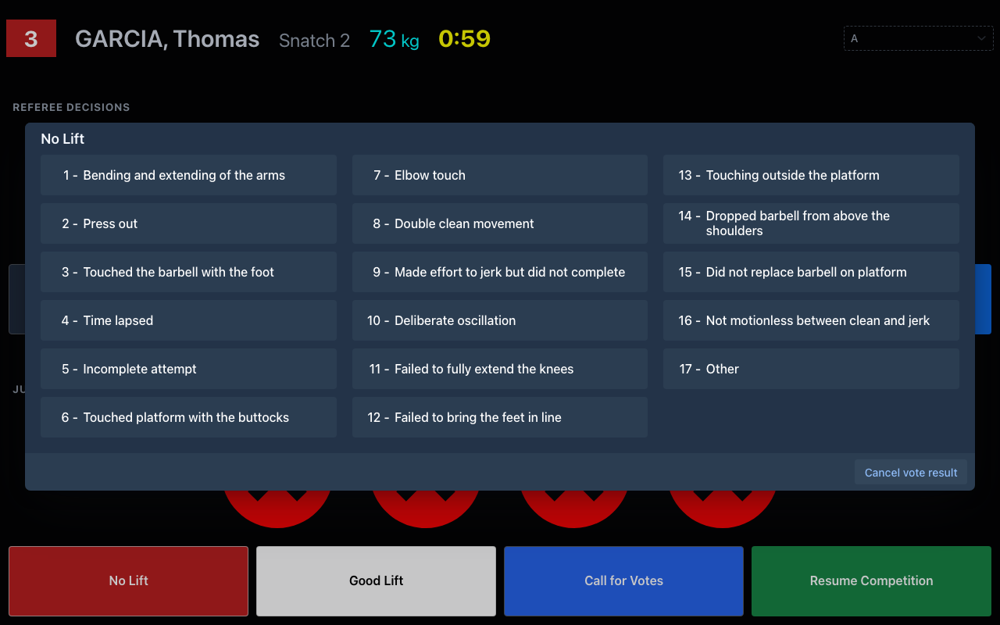

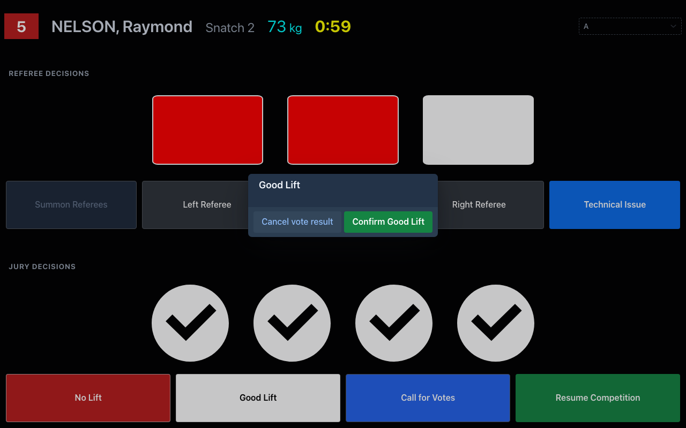

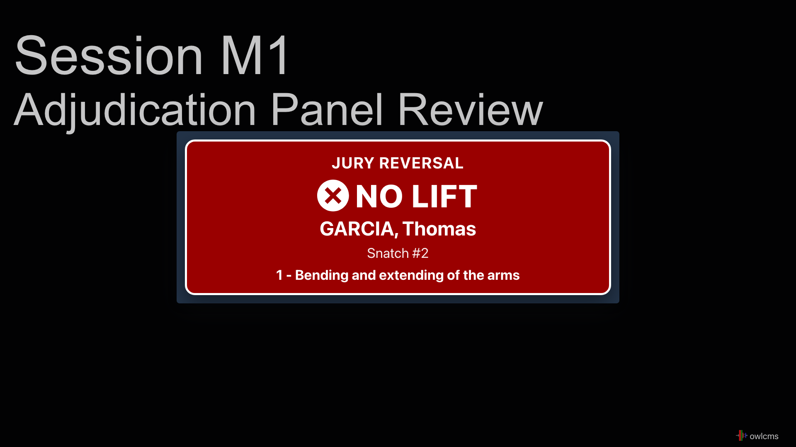

### Decision Without a Vote

If the vote cannot take place (for example, a jury device does not work), the Jury Chair gives the decision with the **No Lift** or **Good Lift** buttons at the bottom of Jury Control (No Lift asks for the rule).  The speaker is then told that the decision was entered by the Jury Chair.

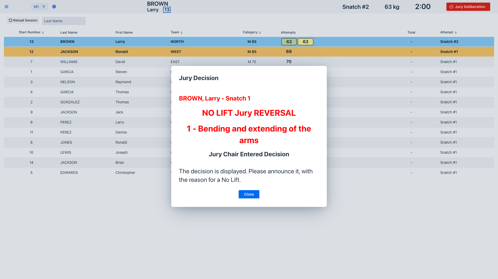

## Juries of 4 (no VPT), 3 and 5 Members

There is no automatic stop.  When the jury's votes on the lift would overturn the referees, the **Summon Referees** button turns orange to remind the chair to call the referees for discussion.

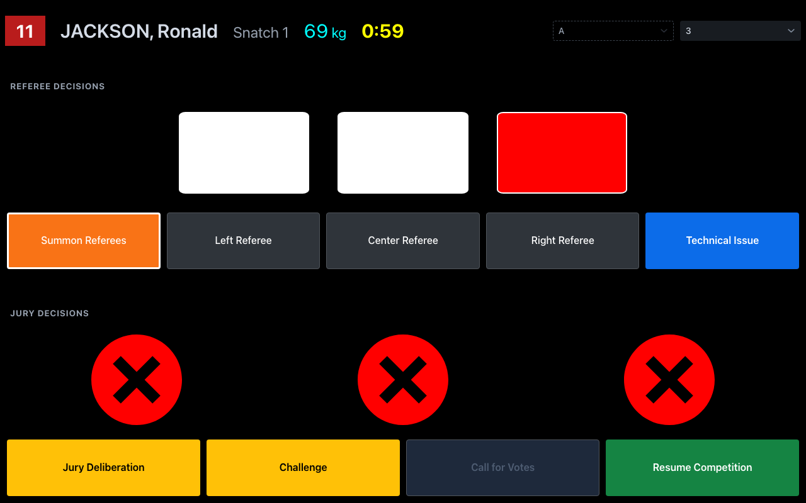

The Chair starts the review with **Jury Deliberation** (or **Challenge**).  The referees' decision stays displayed, the jury lights are cleared, and the jury members vote again right away (the Chair asks for the vote verbally; the referees do not vote).  **Summon Referees** calls the referees to the jury table if the Chair wants to hear them.

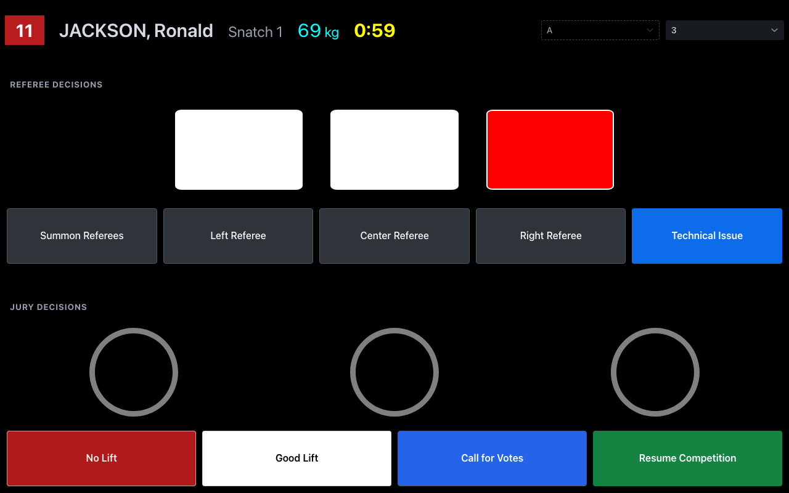

When all the jury members have voted, the votes are revealed and the result waits for the Chair, exactly as for the Adjudication Panel: the rule for a No Lift, a confirmation for a Good Lift, or Cancel vote result.  The jury vote is optional: the Chair can also give the decision directly with the **No Lift** and **Good Lift** buttons.

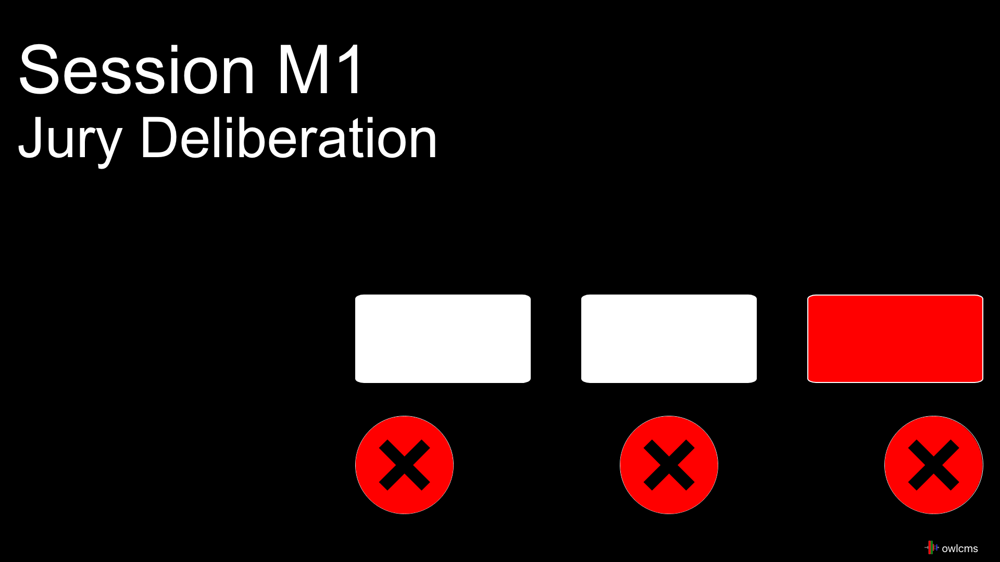

## Speaker

By rule, the speaker announces the decision of the jury and the reason for which a lift was overturned.

- When a review starts, the speaker's screen shows a "Waiting for decision" dialog.
- As soon as the Jury Chair's decision is applied, the dialog shows it with the rule, for the speaker to announce.  The competition does not wait for the announcement: lifting resumes by itself a few seconds after the decision is shown on the boards.

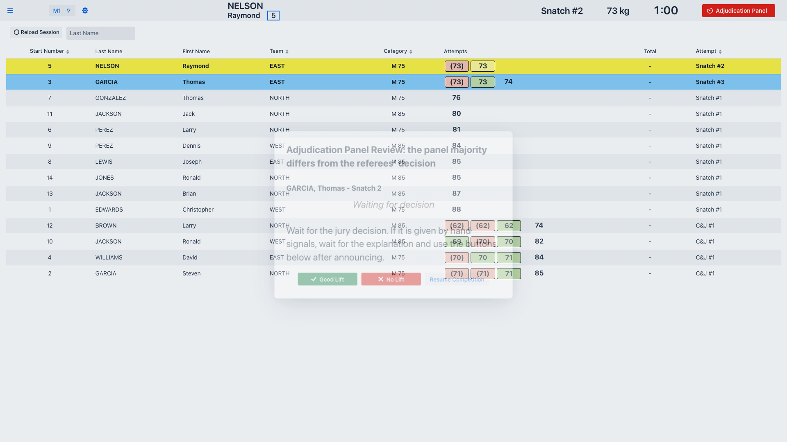

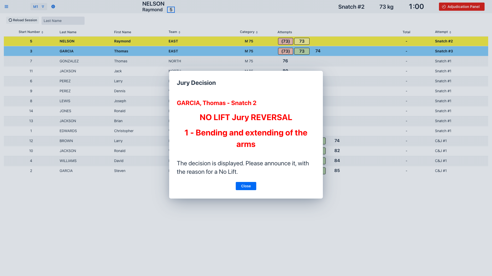

If the jury does not use the Jury Control page (jury box only, and no rule is given), the Technical Controller relays the decision to the speaker, who enters it with the Good Lift / No Lift buttons of the dialog.

## Resume and Other Buttons

- **Resume Competition** ends the jury break and clears the jury votes.  It is not needed when the decision has been given: lifting resumes by itself.
- The **Summon Referees** buttons call the referees to the jury table, during a review or outside one.  The referees get a notification on their device if it is feedback-capable (such as a phone or a full-feedback keypad).  During an Adjudication Panel review, Summon Referees (all) is disabled on the screen because the keypad's Summon All key means Call for Votes.
- **Technical Issue** starts a technical break if the jury notices something is wrong with the platform or the equipment.

## Jury Devices

There are two ways to build jury devices.  The first way is to emulate a keyboard (one-way to owlcms), the second way is to use an Arduino to communicate with owlcms (bi-directional).

### Jury Keypads

You can configure programmable keypads for each of the jury members and for the Jury Chair.  Refer to the [Keypads](../100-AdvancedTopics/180-Keypads) Advanced topic documentation for information.

### Arduino-based Jury Devices

Another way to build a device is to use the MQTT protocol that owlcms supports which provides bi-directional communications.   Commercially available devices that use this approach are being developed (see the [BlueOwl project](https://github.com/scottgonzales/blue-owl)).

But you can in fact use the same approach to build your own devices. Arduino boards are an affordable way to build your own devices.  Designs are available on [this page](https://github.com/owlcms/owlcms-firmata/tree/main/README.md) for working timekeeper, referee, and jury setups.  The Firmata firmware that runs on the Arduino and the [interface program for owlcms](https://github.com/owlcms/owlcms-firmata) are provided.  There is actually nothing to program.

##### Button-only Jury Box

A simple button-only jury control box and the associated jury member buttons, using the owlcms display to look at decisions, is shown here.  This is the same hardware as required to build a jury keypad, except that you don't have anything to program since all the software is already provided.  You would only adjust the configuration file if you needed to use different pins in your build.

 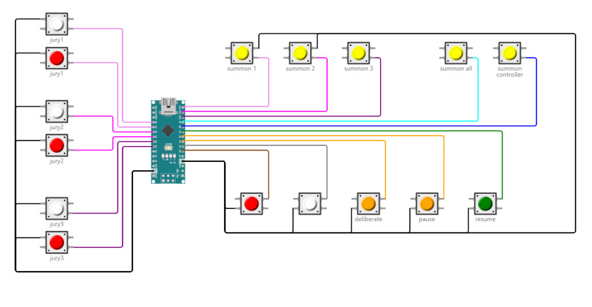

##### Full Jury Control Box with Indicator Lights

A full 5-member jury device is shown below.  In actual practice, you might want to include only 3 or 4 jury members and if so you would only keep that many sets of buttons on the left.   This design includes all the green/red/white indicator lights and uses an Arduino Mega to provide more pins.

 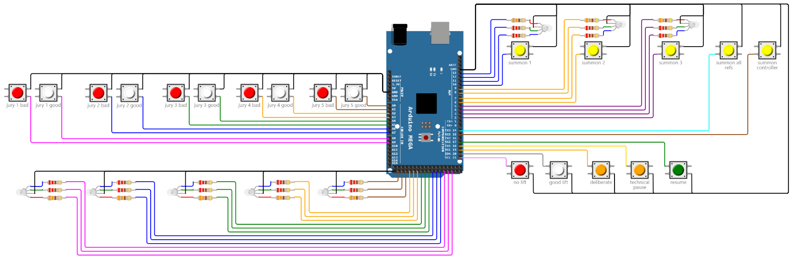

owlcms uses the MQTT protocol used in Internet-Of-Things automation and monitoring applications to talk to the devices.  See the [MQTT](../100-AdvancedTopics/190-MQTT) page for more details and for schematics that you can use for your own devices.  Commercially available pre-built devices using the same protocol are also being developed.
