# Self-Service Jury Replays

The `video` module is a complement to owlcms that, among other features, allows capturing jury replays.  The lifts are automatically trimmed to start a little before the lift and stop after the decisions have been shown.  The jury can watch them using a regular browser, and the replays are organized by session and time (most recent first)

### Starting the Video Module

The video module is started from the control panel, but is not on by default.  You need to enable it.  You will then be offered to install it.

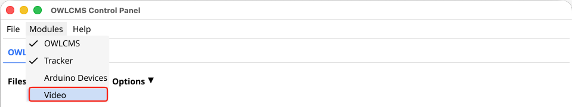

Once installed, you get the usual control panel look, and you start the program using the highlighted button.  Updates and multiple versions work exactly the same as the other modules.

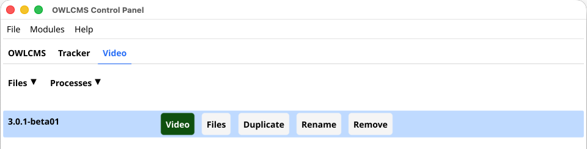

Starting the module brings us to a monitoring page where we start cameras.  For the purpose of this tutorial, we will start a Logitech webcam attached to our laptop.  

By default, the program intentionally hides the built-in cameras since we don't use those for replays.  It only shows cameras that were previously configured.  In this example, we have previously configured 4 cameras, so these are visible.

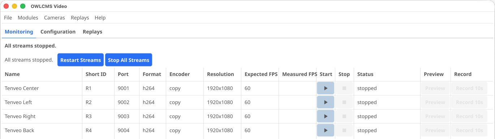

In order to perform tests at home before a meet, it is convenient to use the built-in cameras, so we enable them from the Cameras menu.

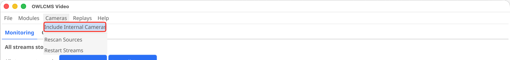

and the Configuration menu shows all that have been seen. On a Mac, this will include your phone as a linked camera, we disable it.

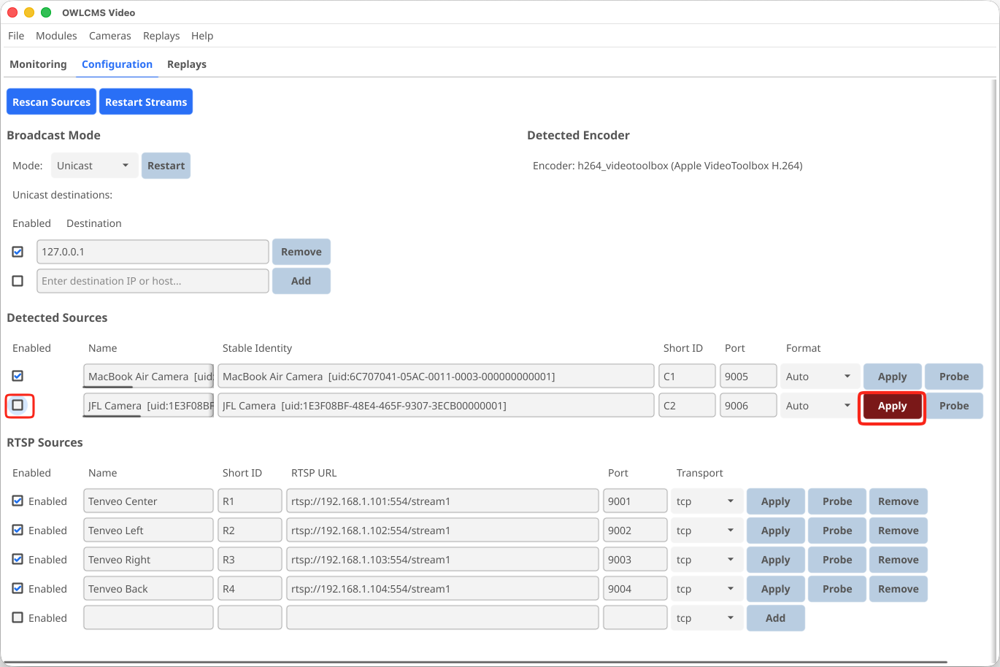

Going back to the monitoring page, we start the built-in camera. The preview button allows you to see what is being captured.

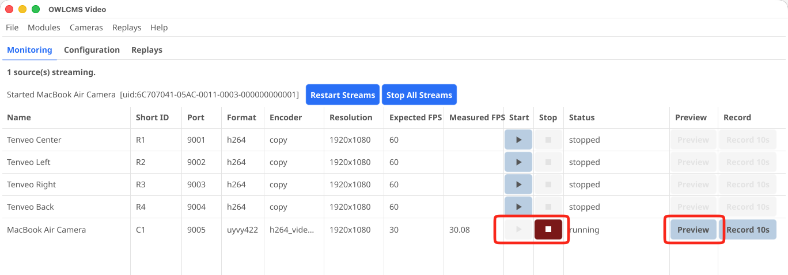

## Setting up replay cameras

From the Replays tab, we use the Select Cameras button.  In our initial test, we don't have our actual replay cameras at home, so we unselect them.  We only keep our built-in camera.  At the competition site, we will select the real cameras, of course.

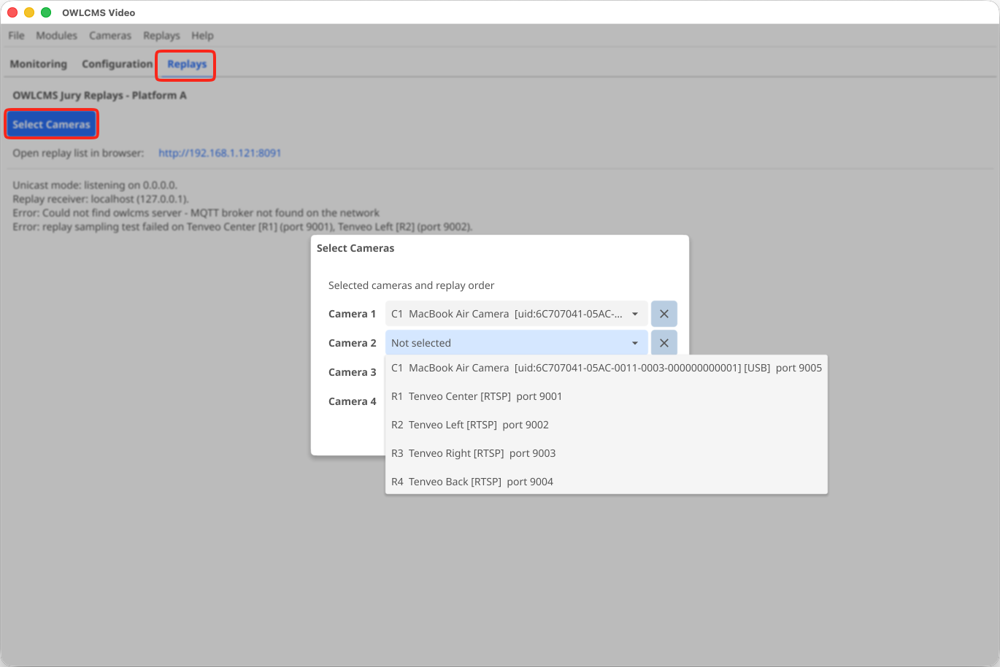

## Testing Replays

1. Start OWLCMS with some data: a session with some weighed-in athletes

2. Check that the Replays module found OWLCMS (1). If not, give the address using the menu (2) and restart the Replays module (3).

   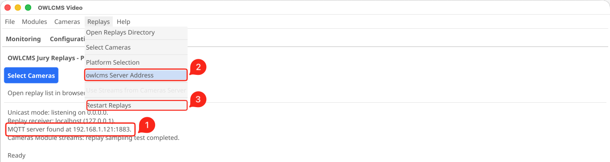

3. Click on the link at the top of the replays window

   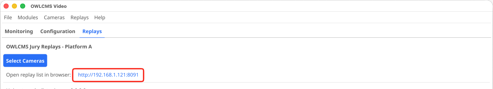

   You should see something like this

   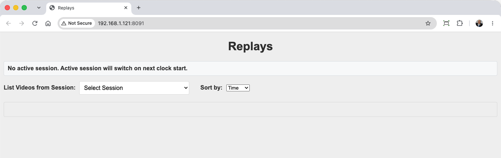

4. In OWLCMS, run start the session and start the clock.  

   1. Let the clock run for 10 seconds, then show a "thumbs up" to the camera, stop the clock.
   2. Wait 10 seconds, then enter your bad lift decision (you can use the controls on the announcer screen) - show a "thumbs down" towards your laptop camera.

   What should happen: during the time from the start of the clock to about 5 seconds after decision, the replays screen should show that it is recording

   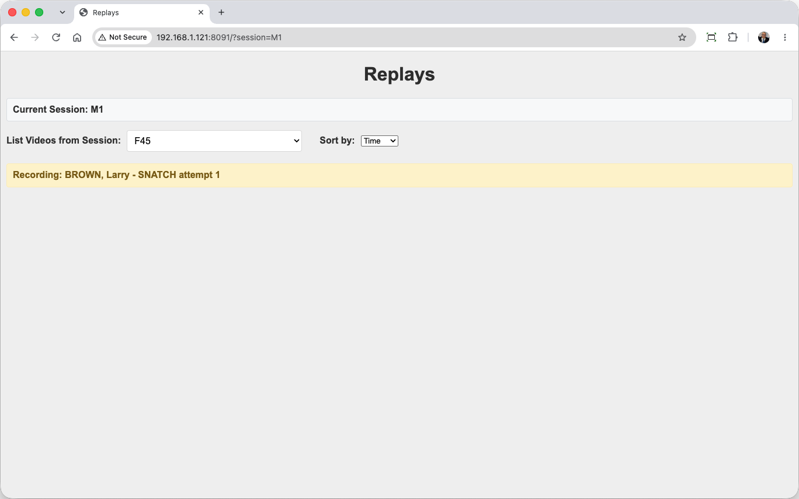

   After the lift, you should see "Ready" and the video added to the list at the top.
   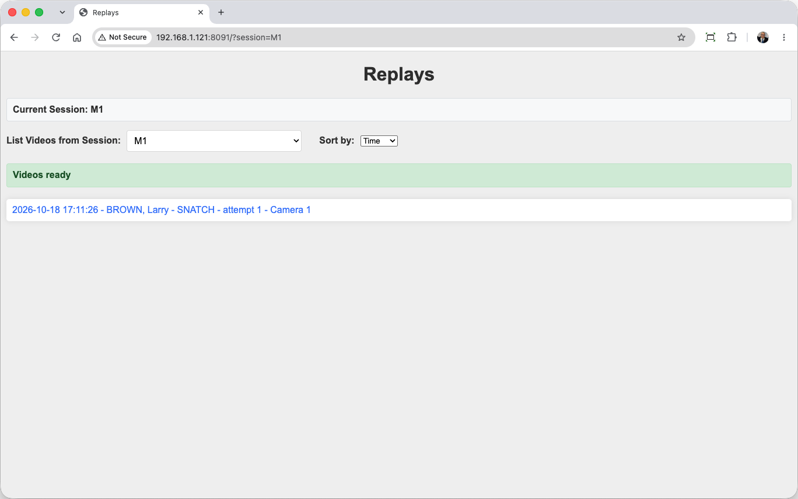

### Watching Replays

The jury can simply get this screen and click on the links.  This will open the standard video browsing experience from the browser.

For an easier experience, there is a tracker module that can fetch the videos and make a nicer interface.

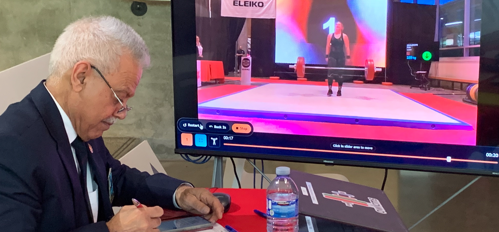
