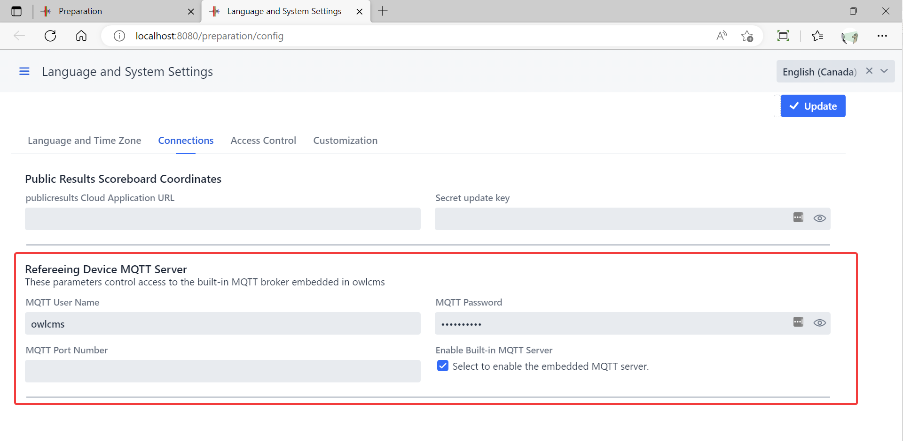

## MQTT

MQTT connects OWLCMS to referee, jury and timekeeper devices. OWLCMS includes an MQTT server for these connections.

For build-your-own devices based on owlcms-firmata, commercial Blue Owl devices and fully custom implementations, see [Refereeing Devices](../060-Refereeing/015-RefereeingDevices). This page describes broker and connection settings. [MQTT Messages](./200-MQTTMessages) describes the protocol.

### Optional configuration of the embedded MQTT server

By default, owlcms will start an MQTT server in anonymous mode. If there is no username,  any process can connect to the owlcms machine on port 1883 using any username and any password.

If you have a wired network with no wifi you might be comfortable doing that, but we do suggest that you add a  username and password.

##### Configuration using the user interface

The simplest way of doing this is using the user interface.  The values you set in these fields are the values you will use from your MQTT device controllers.



> These fields were previously used to configure how owlcms connected to an external server such as Mosquitto or aedes.  *They no longer control the external server.*  If you need to connect to an external server, you will need to use the [Using an External MQTT Server](#using-an-external-mqtt-server) method described at the end of this page

##### Configuration using the configuration file or environment variables

If you configure the MQTT Server in the database, the settings are valid when that database is in use.

If you want something more permanent you can use either environment variables or Java system properties.

On Windows, you can do as follows

1. Go to the installation directory, and locate the `owlcms.l4j.ini` file (depending on your Windows configuration, the `.ini` extension can be hidden).  
2. The following three properties can be defined -- they play the same role as the fields in the database.

```bash
# MQTT for refereeing devices
-DmqttUserName=owlcms
-DmqttPassword=some_Password_you_choose
-DmqttPort=1883
```

> NOTE that the variable `mqttServer` is NOT defined (see the next section)

3. You can also use the three equivalent environment variables OWLCMS_MQTTUSERNAME, OWLCMS_MQTTPASSWORD and OWLCMS_MQTTPORT

### MQTT over WebSocket

When owlcms starts the embedded MQTT server, it also enables MQTT over WebSocket. WebSocket clients must use the path `/mqtt`.

Most clients should connect through the normal owlcms HTTP port:

```text
ws://<owlcms-host>:<owlcms-http-port>/mqtt
```

For a local owlcms instance using the default HTTP port, this is:

```text
ws://localhost:8080/mqtt
```

For a cloud deployment such as Fly.io, use the HTTPS/WebSocket Secure endpoint:

```text
wss://<your-app>.fly.dev/mqtt
```

Internally, owlcms proxies these connections to the embedded Moquette WebSocket listener. That direct listener defaults to port `9090`. This is an advanced/internal setting; most installations should leave it unchanged and should not expose it publicly.

If the internal port conflicts with another process, it can be changed with either:

```bash
-DmqttWsPort=9090
OWLCMS_MQTTWSPORT=9090
```

For direct broker testing only, a client that can reach the embedded Moquette WebSocket port may use:

```text
ws://<owlcms-host>:9090/mqtt
```


## Using an External MQTT Server

The Fly.io service doesn't allow for the owlcms server to provide both HTTP and MQTT services.  For these situations, we must use a separate server and define the environment variable OWLCMS_MQTTSERVER to indicate its location.  There is no need to use a separate MQTT server when using owlcms locally as the performance of the embedded server is on par with standalone servers.

As soon as owlcms detects OWLCMS_MQTTSERVER, it disables the embedded server and uses instead the parameters given to reach the external MQTT Server.  The external MQTT server cannot be configured using the Web interface.

HiveMQ provides free accounts ([see here](https://console.hivemq.cloud)) that are sufficient for running owlcms.  To use such an account, you would define "*secrets*" on fly.io -- they are stored in an encrypted format.   owlcms sees them as environment variables. You need to provide the following values (obviously, use your own values).:

| Variable            | Value                                                        |
| ------------------- | ------------------------------------------------------------ |
| OWLCMS_MQTTSERVER   | 44341a3e47cc48d2b260b8064120f2df.s2.eu.hivemq.cloud          |
| OWLCMS_MQTTPORT     | 8883 (external servers require a TLS connection, owlcms will use TLS if the port starts with 8) |
| OWLCMS_MQTTUSERNAME | your_username (one of the user names you created using the Access Management > Credentials page) |
| OWLCMS_MQTTPASSWORD | some_Password_you_choose (the password associated with the credential) |

For testing, you might want your local owlcms to connect to the remote MQTT.  This can also be done using -D system property definitions instead of variables.   You would then modify the `owlcms.l4j` initialization file in the installation directory to have the following (or add these values to the `java` command line)

```bash
-DmqttServer=44341a3e47cc48d2b260b8064120f2df.s2.eu.hivemq.cloud
-DmqttUserName=your_username
-DmqttPassword=some_Password_you_choose
-DmqttPort=8883
```

